# DomiExpress: Documento de diseño

## Principios de POO

| Principio | Dónde | Justificación |
|-----------|-------|---------------|
| Abstracción | `Producto` | Define `calcularPrecio()` sin implementarlo; cada hijo decide cómo calcularlo. |
| Encapsulamiento | `Producto`, `Pedido`, `Combo` | Atributos `private final`, validación en constructores y copias defensivas (`List.copyOf`). |
| Herencia | `Producto` → `Comida`, `Bebida`, `Combo` | Comparten nombre y precio base; cada una aporta su cálculo. |
| Polimorfismo | `Pedido.calcularTotal()` | Recorre `Producto` y llama `calcularPrecio()` sin `instanceof`. |

## Principios SOLID

| Principio | Dónde | Justificación |
|-----------|-------|---------------|
| SRP | `Pedido`, `GeneradorFactura` | `Pedido` solo calcula y guarda estado; la factura vive en otra clase. |
| OCP | `MetodoPago`, `Promocion`, `Notificador` | Un pago, promoción o canal nuevo es una clase nueva. Se demostró con `PagoDaviplata` en un commit que solo agrega un archivo. |
| LSP | `TipoEntrega`, `Domicilio`, `RecogerEnTienda` | Ambas se usan donde se espera un `TipoEntrega`, sin excepciones ni chequeos de tipo. La dirección es dato propio de `Domicilio`. |
| ISP | `PuedeOrdenar`, `PuedeEntregar`, `PuedePrepararPedidos` | Interfaces de un método; `Cliente`, `Repartidor` y `Restaurante` implementan solo lo que usan. |
| DIP | `ServicioPedidos` | Recibe `RepositorioPedidos`, `Notificador` y `GeneradorFactura` por constructor; no hace `new` de infraestructura. |

## Diagrama de clases

```mermaid
classDiagram
    class Producto { <<abstract>> +calcularPrecio() double }
    Producto <|-- Comida
    Producto <|-- Bebida
    Producto <|-- Combo
    Combo o-- Producto

    class Pedido { +calcularTotal() double }
    Pedido o-- Producto

    class MetodoPago { <<interface>> +pagar(monto) }
    MetodoPago <|.. PagoTarjeta
    MetodoPago <|.. PagoPSE
    MetodoPago <|.. PagoNequi
    MetodoPago <|.. PagoEfectivo
    MetodoPago <|.. PagoDaviplata

    class TipoEntrega { <<interface>> +calcularCostoEnvio() double }
    TipoEntrega <|.. Domicilio
    TipoEntrega <|.. RecogerEnTienda

    class Promocion { <<interface>> +calcularDescuento() double }
    Promocion <|.. PromoDosPorUno
    Promocion <|.. PromoPorcentaje
    Promocion <|.. PromoEnvioGratis

    class Notificador { <<interface>> +notificar() }
    Notificador <|.. NotificadorEmail
    Notificador <|.. NotificadorSMS
    Notificador <|.. NotificadorPush

    class RepositorioPedidos { <<interface>> +guardar() }
    RepositorioPedidos <|.. RepositorioEnMemoria

    class ServicioPedidos { +procesar() }
    ServicioPedidos --> RepositorioPedidos
    ServicioPedidos --> Notificador
    ServicioPedidos --> GeneradorFactura
    ServicioPedidos ..> MetodoPago
    ServicioPedidos ..> TipoEntrega
    ServicioPedidos ..> Promocion

    PuedeOrdenar <|.. Cliente
    PuedeEntregar <|.. Repartidor
    PuedePrepararPedidos <|.. Restaurante
```

